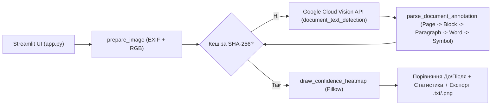

# Handwriting Confidence Analyzer

Proof-of-Concept (PoC) вебзастосунок для оцифрування рукописних і друкованих конспектів із використанням **Google Cloud Vision API** (`document_text_detection`) та візуалізацією **карти впевненості моделі (Confidence Heatmap)** поверх вихідного зображення.

Проєкт виконано в межах завдання з курсу **«Хмарні обчислення»**.

---

## Можливості PoC

- **Завантаження сторінок конспекту:** підтримка форматів `PNG`, `JPG`, `JPEG`, `WEBP` через односторінковий веб-інтерфейс `Streamlit`.
- **Коректна робота з фото зі смартфонів:** автоматична нормалізація EXIF-орієнтації та колірного простору (`RGB`) перед зверненням до API, щоб координати полігонів збігалися з відображуваним зображенням.
- **Інтеграція з Cloud Vision API:** виклик `document_text_detection` та парсинг повної ієрархії відповіді:
  `Page → Block → Paragraph → Word → Symbol`.
- **Confidence Heatmap (`Pillow`):** напівпрозора заливка та контур кожного розпізнаного слова за координатами `bounding_box.vertices`:
  - **Зелений (`#22C55E`)**: висока впевненість (`confidence >= 0.90`)
  - **Помаранчевий / Жовтий (`#F59E0B`)**: середня впевненість (`0.75 <= confidence < 0.90`)
  - **Червоний (`#EF4444`)**: низька впевненість (`confidence < 0.75`)
- **Інтерактивне порівняння «До / Після»:** перегляд оригіналу та розміченої сторінки поруч, налаштування прозорості заливки й товщини контуру без повторних запитів до API (кешування за SHA-256 хешем зображення).
- **Статистика та експорт:** підрахунок середньої впевненості, розподілу слів за рівнями, таблиця слів із впевненістю `< 0.90`, а також завантаження розпізнаного тексту (`.txt`) і карти впевненості (`.png`).

---

## Архітектура проєкту



### Структура репозиторію

```text
.
├── app.py                  # Веб-інтерфейс Streamlit
├── src/
│   ├── __init__.py
│   ├── vision_service.py   # Клієнт Google Cloud Vision API, парсер і статистика
│   └── visualizer.py       # EXIF/RGB-нормалізація та рендеринг Confidence Heatmap
├── tests/
│   ├── __init__.py
│   └── test_analyzer.py    # Модульні тести (pytest) із моками API
├── Dockerfile              # Контейнер для локального запуску та Google Cloud Run
├── .dockerignore
├── requirements.txt
├── env.example             # Шаблон змінних середовища
├── .gitignore              # Виключення ключів GCP (*.json), .env та .venv
└── README.md
```

---

## Налаштування Google Cloud Platform (GCP)

1. Відкрийте [Google Cloud Console](https://console.cloud.google.com/) та оберіть або створіть проєкт.
2. Увімкніть **Cloud Vision API**:
   ```bash
   gcloud services enable vision.googleapis.com
   ```
3. Створіть **Service Account** та згенеруйте JSON-ключ:
   - Перейдіть у **IAM & Admin → Service Accounts → Create Service Account**.
   - Створіть ключ у форматі **JSON** (`Keys → Add Key → Create new key → JSON`).
   - Збережіть завантажений файл у корені проєкту як `credentials.json` (файл автоматично ігнорується через `.gitignore`).
4. Створіть `.env` на основі `env.example`:
   ```bash
   cp env.example .env
   ```
   Переконайтеся, що у `.env` вказано коректний шлях:
   ```env
   GOOGLE_APPLICATION_CREDENTIALS=./credentials.json
   ```

> **Альтернатива для локальної розробки:** можна використати Application Default Credentials без окремого JSON-ключа:
> ```bash
> gcloud auth application-default login
> ```

---

## Локальний запуск

Вимоги: **Python 3.10+** (протестовано на Python 3.12).

```bash
# 1. Створення та активація віртуального середовища
python3 -m venv .venv
source .venv/bin/activate

# 2. Встановлення залежностей
pip install -r requirements.txt

# 3. Запуск веб-застосунку
streamlit run app.py
```

Після запуску інтерфейс буде доступний за адресою `http://localhost:8501`.

### Запуск тестів

Модульні тести використовують моки відповіді Cloud Vision API та не потребують активних GCP-ключів:

```bash
pytest -v
```

---

## Контейнеризація та деплой у Google Cloud Run

### Локальна перевірка Docker

```bash
docker build -t handwriting-confidence-analyzer .

# Запуск із монтуванням ключа GCP (ключ не потрапляє всередину образу)
docker run --rm -p 8501:8501 \
  -v "$(pwd)/credentials.json:/app/credentials.json:ro" \
  -e GOOGLE_APPLICATION_CREDENTIALS=/app/credentials.json \
  handwriting-confidence-analyzer
```

### Деплой у Cloud Run

У середовищі Cloud Run застосунок автоматично використовує вбудовану автентифікацію Service Account (ADC) та слухає змінну середовища `$PORT`:

```bash
gcloud run deploy handwriting-confidence-analyzer \
  --source . \
  --region europe-central2 \
  --allow-unauthenticated
```

---

## Автор

- **Виконавець:** Віктор Сікора (Viktor Sikora)
- **Університет:** Київський національний університет імені Тараса Шевченка (КНУ)
- **Факультет:** Факультет комп'ютерних наук та кібернетики (ФКНК)
- **Кафедра:** Кафедра теоретичної кібернетики
- **Курс та група:** 4 курс, група ТК-42
- **Email:** vsikora@knu.ua
- **GitHub:** [https://github.com/jamessmithf](https://github.com/jamessmithf)
