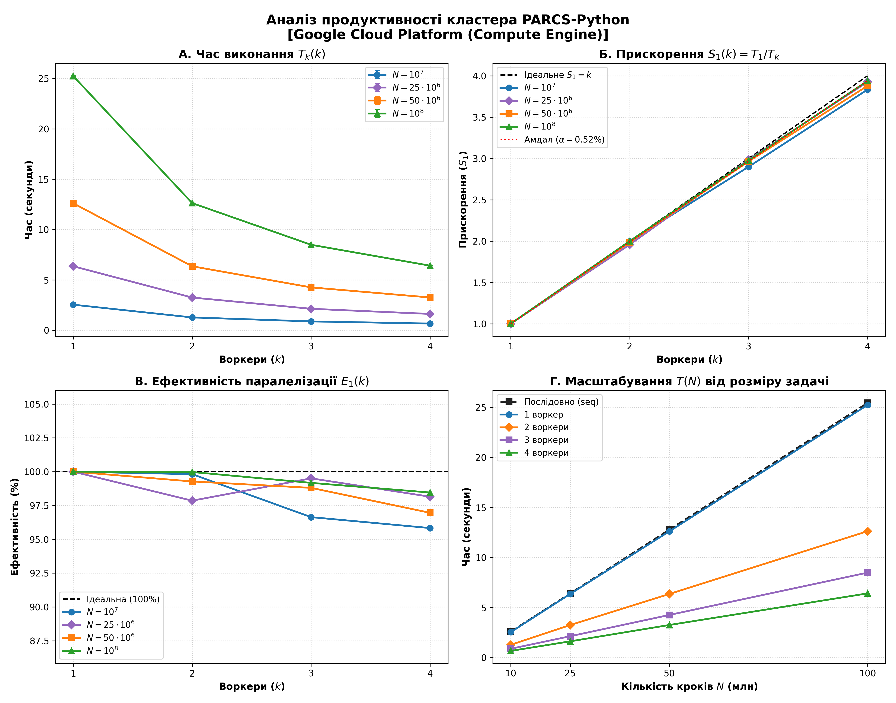

# Розподілене чисельне інтегрування в середовищі PARCS-Python (Google Cloud Platform)

[](https://www.python.org/)
[](https://hub.docker.com/r/hummer12007/parcs-node/)
[](https://cloud.google.com/compute)
[](docs/%D0%97%D0%B2%D1%96%D1%82_%D0%9B%D0%A01_PARCS_%D0%A1%D1%96%D0%BA%D0%BE%D1%80%D0%B0.pdf)

> [!TIP]
> 📄 **Готовий академічний звіт (PDF):** [docs/Звіт_ЛР1_PARCS_Сікора.pdf](docs/%D0%97%D0%B2%D1%96%D1%82_%D0%9B%D0%A01_PARCS_%D0%A1%D1%96%D0%BA%D0%BE%D1%80%D0%B0.pdf)

Лабораторна робота №1 з дисципліни **«Хмарні обчислення»**  
**Київський національний університет імені Тараса Шевченка**  
**Факультет комп'ютерних наук та кібернетики (ФКНК)**  
**Кафедра:** теоретичної кібернетики  
**Виконавець:** студент 4 курсу, група **ТК-42**, **Сікора Віктор (Viktor Sikora)**  
**Пошта:** [vsikora@knu.ua](mailto:vsikora@knu.ua) | **GitHub:** [jamessmithf](https://github.com/jamessmithf)

---

## 1. Постановка задачі

Розгортання розподіленої системи **PARCS-Python** (`hummer12007/parcs-node`, Python 2.7 + Pyro4 + Flask) у **Google Cloud Platform (Compute Engine)** та дослідження масштабованості паралельного алгоритму чисельного інтегрування методом середніх прямокутників:

$$I = \int_0^1 \frac{4}{1 + x^2}\,dx = 4\arctan(1) = \pi \approx 3.141592653589793$$

$$h = \frac{b - a}{N}, \quad \hat{I} = h \sum_{i=0}^{N-1} f\!\left(a + (i + 0.5)h\right)$$

- **Map:** майстер розбиває $N$ кроків на $k$ підінтервалів із точним розподілом остачі $N \bmod k$ (різниця не перевищує 1 крок, права межа останнього підінтервала примусово дорівнює $b$) і асинхронно викликає `worker.mymap(a_i, b_i, n_i)` через Pyro4.
- **Reduce:** майстер відстежує готовність кожного `FutureResult` (`futures[i].ready`), підсумовує часткові інтеграли у `myreduce()`, перевіряє точність за теоретичною межею похибки $|E_M| \le \frac{(b-a)^3}{3 N^2}$ та записує результат із детальною телеметрією `# TIMING {json}` у `output.txt`.

---

## 2. Структура репозиторію

```text
Lab_PARCS/
├── src/
│   ├── solver.py                       # Розв'язок PARCS-Python (Solver, mymap, myreduce, integrate_chunk, # TIMING)
│   ├── baseline.py                     # Послідовний еталон на базі того самого ядра integrate_chunk
│   ├── driver.py                       # Єдиний драйвер бенчмарків (працює всередині контейнера майстра)
│   ├── generate_input.py               # Генератор вхідних файлів (1M..100M)
│   ├── test_solver_local.py            # Модульні тести (1, 2, 4 воркери)
│   ├── test_edge_cases.py              # 10 тестів крайових випадків
│   └── run_comprehensive_edge_tests.py # Комплексна перевірка (4 вектори надійності + живий кластер)
├── deploy/
│   ├── docker-compose.yml              # Локальний кластер із CPU pinning (cpus: 1.0, cpuset: 0,2,4,6,8)
│   ├── start_local_cluster.sh          # Запуск локального кластера
│   ├── stop_local_cluster.sh           # Зупинка локального кластера
│   ├── run_cluster_benchmark.py        # Запуск driver.py всередині локального контейнера parcs-master
│   ├── 00_install_gcloud.sh            # Перевірка / встановлення gcloud CLI
│   ├── 01_gcp_init_project.sh          # Ініціалізація проєкту, зони та білінгу GCP
│   ├── 02_gcp_setup_firewall.sh        # Least-privilege Firewall (10.0.0.0/8 + :8080 лише для IP студента /32)
│   ├── 03_gcp_deploy_master.sh         # Перевірка квот + Master VM (COS, 10GB, --max-run-duration=8h)
│   ├── 04_gcp_scale_workers.sh         # 4 Worker VMs із передачею parcs-master-ip через метадані
│   ├── 05_gcp_run_benchmark.py         # Контролер хмарних замірів (--quick, --wait, --status, --fetch)
│   ├── 06_gcp_cleanup.sh               # Видалення VM (--delete-disks=all), дисків, фаєрволу + аудит залишків
│   ├── gcp_deploy_all.sh               # Повне розгортання GCP однією командою
│   ├── gcp_demo.sh                     # Хелпер для живого захисту (оновлення IP у фаєрволі + чекліст)
│   └── remote.sh                       # Фоновий запуск driver.py на Master VM (docker exec -d)
├── benchmarks/
│   ├── results-cloud/                  # Повні хмарні результати GCP (summary.csv, results.csv, results.json, progress.log)
│   ├── results-local/                  # Повні локальні результати Docker (CPU-pinned)
│   ├── plot_benchmarks.py              # Генератор графіків продуктивності (300 DPI)
│   └── *.png                           # Згенеровані графіки (локальні та GCP)
├── docs/
│   └── Звіт_ЛР1_PARCS_Сікора.pdf       # Згенерований академічний звіт на реальних даних GCP
├── screenshots/                        # Скріншоти розгортання в GCP (VM, Firewall, Nodes, Jobs, Output)
└── README.md                           # Документація проєкту
```

---

## 3. Швидкий старт

### Локальний кластер Docker (CPU-pinned)
```bash
cd deploy/
./start_local_cluster.sh
python3 run_cluster_benchmark.py            # 60 запусків (N=10M..100M, seq + k=1..4, 3 повтори)
./stop_local_cluster.sh
```

### Хмарний кластер Google Cloud Platform (Compute Engine)
```bash
cd deploy/
# 1. Розгорнути 1 майстер + 4 воркери n1-standard-1 (із перевіркою квот, захищеним Firewall та 8h guard)
./gcp_deploy_all.sh <PROJECT_ID> 4 europe-west1 europe-west1-b n1-standard-1

# 2. Швидка перевірка (~1 хв) і повні хмарні заміри (~8–10 хв, працюють у фоні на Master VM)
python3 05_gcp_run_benchmark.py --quick --wait
python3 05_gcp_run_benchmark.py --wait

# 3. ОБОВ'ЯЗКОВО видалити кластер і перевірити аудит залишків
./06_gcp_cleanup.sh
```

### Генерація графіків
```bash
python3 benchmarks/plot_benchmarks.py
```

---

## 4. Результати експериментів у Google Cloud Platform

**Середовище:** Google Compute Engine, `europe-west1-b` (Бельгія), 5 × `n1-standard-1` (1 vCPU, 3.75 ГБ ОЗП, `Intel(R) Xeon(R) CPU @ 2.30GHz`), Container-Optimized OS, Docker `hummer12007/parcs-node` (Python 2.7.13).  
**Методика:** 60 запусків (`N ∈ {10M, 25M, 50M, 100M}`, `seq + k ∈ {1, 2, 3, 4}`, по 3 повтори). Усі 60 запусків пройшли перевірку точності та збіглися з послідовною версією (`all_correct = True`).  
Сирі дані: [benchmarks/results-cloud/summary.csv](benchmarks/results-cloud/summary.csv), [results.csv](benchmarks/results-cloud/results.csv), [results.json](benchmarks/results-cloud/results.json).

### 4.1. Середній час виконання та прискорення (GCP)

| $N$ | $T_{seq}$, с | $T_1$, с | $T_2$, с | $T_3$, с | $T_4$, с | $S(4) = T_{seq}/T_4$ | $S_1(4) = T_1/T_4$ | $E_1(4)$ |
|---:|---:|---:|---:|---:|---:|---:|---:|---:|
| $10^7$ | $2.58 \pm 0.06$ | $2.54 \pm 0.01$ | $1.27 \pm 0.00$ | $0.87 \pm 0.00$ | $0.66 \pm 0.02$ | **3.90×** | **3.83×** | 95.8% |
| $25 \cdot 10^6$ | $6.40 \pm 0.03$ | $6.35 \pm 0.01$ | $3.25 \pm 0.14$ | $2.13 \pm 0.01$ | $1.62 \pm 0.02$ | **3.96×** | **3.93×** | 98.2% |
| $50 \cdot 10^6$ | $12.78 \pm 0.03$ | $12.61 \pm 0.02$ | $6.35 \pm 0.09$ | $4.25 \pm 0.02$ | $3.25 \pm 0.03$ | **3.93×** | **3.88×** | 97.0% |
| **$10^8$** | **$25.44 \pm 0.08$** | **$25.24 \pm 0.03$** | **$12.62 \pm 0.00$** | **$8.48 \pm 0.03$** | **$6.41 \pm 0.03$** | **3.97×** | **3.94×** | **98.5%** |

### 4.2. Складові часу для $N = 10^8$ у GCP (середнє по 3 запусках)

| Воркери $k$ | $T_k$, с | $\max T_{comp}$, с | $\max T_{transfer}$, с | Дисбаланс | $T_{job}$, с | Похибка $\|\hat{I} - \pi\|$ |
|:---:|---:|---:|---:|---:|---:|---:|
| 1 | 25.24 | 25.23 | 0.0058 | 1.000 | 26.28 | $6.33 \times 10^{-13}$ |
| 2 | 12.62 | 12.61 | 0.0083 | 1.000 | 13.53 | $1.16 \times 10^{-13}$ |
| 3 | 8.48 | 8.47 | 0.0108 | 1.005 | 9.91 | $2.23 \times 10^{-13}$ |
| 4 | 6.41 | 6.39 | 0.0134 | 1.008 | 8.22 | $1.10 \times 10^{-13}$ |

- **Комунікація:** частка передачі даних і RPC при $k = 4$, $N = 10^8$ становить лише **0.21%** від $T_4$ (`0.0134 с`).
- **Закон Амдала:** за $S_1(4) = 3.9383$ ефективна послідовна частка становить $\alpha \approx \mathbf{0.52\%}$ (паралельна частка $f = 99.48\%$).
- **Локальний Docker (CPU-pinned, 5 P-ядер i7-12650H):** для $N = 10^8$ отримано $T_{seq} = 10.58\text{ с}$, $T_1 = 10.56\text{ с}$, $T_4 = 3.43\text{ с}$, $S_1(4) = 3.08\times$ (обмежено зниженням частоти Turbo Boost при одночасному завантаженні 4 ядер ноутбука; див. [benchmarks/results-local/summary.csv](benchmarks/results-local/summary.csv)).

---

## 5. Графіки та скріншоти Google Cloud



- Окремі графіки GCP: [gcp_speedup_comparison.png](benchmarks/gcp_speedup_comparison.png) · [gcp_efficiency_comparison.png](benchmarks/gcp_efficiency_comparison.png) · [gcp_execution_time.png](benchmarks/gcp_execution_time.png)
- Скріншоти розгортання в GCP: [gcp_vms.png](screenshots/gcp_vms.png) · [gcp_firewall.png](screenshots/gcp_firewall.png) · [gcp_nodes.png](screenshots/gcp_nodes.png) · [gcp_jobs.png](screenshots/gcp_jobs.png) · [gcp_output.png](screenshots/gcp_output.png)
- Локальні графіки (Docker CPU-pinned): [performance_dashboard.png](benchmarks/performance_dashboard.png)

---

## 6. Література

1. Дерев’янченко О. В. *ПАРКС-JAVA система для паралельних обчислень на комп’ютерних мережах*: Навчальний посібник. – К.: ВПЦ «Київський університет», 2011. – 60 с.
2. Anisimov A., Derevianchenko O., Kuliabko P., Fedorus O. *PARCS Technology: Concept and Implementations* // Cybernetics and Systems Analysis. – 2023. – Vol. 59, No. 1. – P. 166–179.
3. Дерев’янченко О. В., Сакевич Р. Д. *Застосування системи ПАРКС-Java та Google Cloud Platform для хмарних обчислень* // Вісник КНУ імені Тараса Шевченка. Серія: ФМН. – 2017. – № 4. – С. 69–74.
